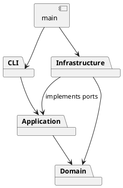

# Lab1 Phase 1：架构方案与开发记录

## 架构方案（实施前）

采用 TypeScript 严格模式、面向对象、一类一文件。阶段范围为 rect、circle、ellipse、line、text、g；box 与插件加载留到后续阶段。

| 模块 | 职责 |
|---|---|
| `src/domain` | 图形类层次、组合树、画布、几何与结构约束；不依赖 IO |
| `src/application` | 编辑会话、Command 对象、撤销历史、输入验证、IO 端口 |
| `src/infrastructure` | SVG XML 编解码、文件读写适配器 |
| `src/cli` | 分词、命令分发、输出及 REPL |
| `src/main.ts` | 组装具体依赖并启动 |
| `test` / `examples` | 自动验收与可回放案例 |

使用 Command（每条编辑命令为对象）、Composite（Group 与叶子同一操作接口）、Memento（命令前后快照）、Factory（六种图形构造）和 Adapter（XML、文件系统）。CLI 命令名分发与 ShapeFactory 类型名分发是仅有的两处名称分派点，后续插件阶段待重构为注册入口。本阶段不虚构插件能力。

依赖只可向内：domain 不引用其他层；application 只引用 domain 及自身端口；infrastructure 实现 application 端口且可引用 domain；cli 引用 application，不引入具体文件 IO；main 负责接线。业务对象封装字段，通过方法维护约束，禁止外部直接改树。

变化点：新增图形由子类和工厂承担；新增命令由 Command 子类和分发入口承担；未来 GUI 可调用会话与 Command；更换存储可替换文件端口；大文档可将快照替换为增量撤销，当前选择快照保证跨父节点操作的原子性。完整 SVG/CSS 渲染及插件加载不在本阶段实现。

## 过程记录

1. 2026-11-05：读取题目，确认必须实际分步提交；先建立架构与构建配置，再推进实现。GitHub 连接尝试失败，用户说明尚未创建仓库，因此先准备本地仓库。
2. 实施前识别风险：group 同时选择祖先与子孙、读入缺 id 与后出现的显式 id 冲突、失败命令误改 undo/redo 栈、文档命令后的撤销屏障。后续以对应测试验证。

此记录由 AI 助手在真实开发过程中维护；不将 AI 的自查冒充为学生本人提出的问题或讨论。学生提交前应阅读理解，并补充自己的真实复核过程。

## 一致性自查

实施完成后记录实际目录与依赖检查结果。

## 质量保证手段

计划通过 TypeScript 严格编译、Node 内置测试运行器、CLI 脚本回放及 SVG 往返验证覆盖命令、撤销、错误原子性与文件行为。
