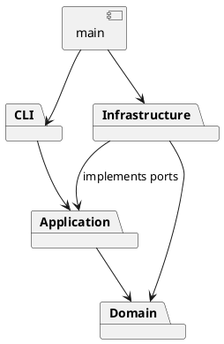

# Lab1 Phase 1：架构方案与开发记录

## 架构方案

采用 TypeScript 严格模式、面向对象、一类一文件。阶段范围为 rect、circle、ellipse、line、text、g；box 与插件加载留到后续阶段。

| 模块 | 职责 |
|---|---|
| `src/domain` | 图形类层次、组合树、画布、几何与结构约束；不依赖 IO |
| `src/application` | 编辑会话、Command 对象、撤销历史、输入验证、IO 端口 |
| `src/infrastructure` | SVG XML 编解码、文件读写适配器 |
| `src/cli` | 分词、命令分发、输出及 REPL |
| `src/main.ts` | 组装具体依赖并启动 |
| `test` / `examples` | 自动验收与可回放案例 |

使用 Command（每条编辑命令为对象）、Composite（Group 与叶子同一操作接口）、Memento（命令前后快照）、Factory（六种图形构造）和 Adapter（XML、文件系统）。CLI 命令名分发与 ShapeFactory 类型名分发是仅有的两处名称分派点，后续插件阶段待重构为注册入口。本阶段不虚构插件能力。

### 设计模式如何落地

| 模式 | 代码位置 | 实现理由 |
|---|---|---|
| Command | `application/Command.ts`、`EditCommand.ts`、`commands/*Command.ts` | 每条命令均为对象，`execute` 提供统一入口。编辑命令独立实现 `apply`；`CommandHistory` 作为调用者保存可撤销命令对象 |
| Memento | `EditCommand` 的私有 before/after 快照 | 执行时克隆候选文档，只在全部操作成功后替换会话；undo/redo 还原快照，不用不精确的反向浮点运算 |
| Composite | `domain/Shape.ts`、`Group.ts`、`GeometryShape.ts` | 叶子与组统一实现 move/scale/set/clone；组递归处理孩子。set 采用 SVG 组样式继承，而非硬编码逐个改写孩子 |
| Factory | `domain/ShapeFactory.ts` | CLI 创建与 XML 导入共享同一类型构造表；行为由具体图形类多态实现，序列化没有 switch(tag) |
| Adapter / 依赖倒置 | `application/ports.ts`、`infrastructure/*` | 会话仅依赖 FileStore、SvgCodec 接口，测试可用内存文件，XML 与磁盘 IO 不进入核心 |

`Shape` 封装 id 与展示属性，`GeometryShape` 封装几何字段并校验数值，具体形状封装克隆与概要格式。`Group` 封装孩子数组；返回数组副本防止调用者绕过插入/删除方法。`Drawing` 维护全局唯一 id、父子关系、顺序与循环约束。接口参数、XML 属性字典和分词数组是边界数据，不承担业务模型职责。

依赖只可向内：domain 不引用其他层；application 只引用 domain 及自身端口；infrastructure 实现 application 端口且可引用 domain；cli 引用 application，不引入具体文件 IO；main 负责接线。业务对象封装字段，通过方法维护约束，禁止外部直接改树。

变化点：新增图形由子类和工厂承担；新增命令由 Command 子类和分发入口承担；未来 GUI 可调用会话与 Command；更换存储可替换文件端口；大文档可将快照替换为增量撤销，当前选择快照保证跨父节点操作的原子性。完整 SVG/CSS 渲染及插件加载不在本阶段实现。

### 原子性与历史规则

编辑命令执行顺序：`CommandRouter → EditorSession → CommandHistory → EditCommand → Drawing/Shape`。候选树中即使某个孩子修改成功而另一个数值溢出，也不会发布候选树；历史栈仅在命令完成后更新。失败的新编辑不清除 redo。成功的新编辑会清除 redo。

`init/read/save/canvas 修改` 成功后设置历史屏障并清空两个栈；undo 和 redo 都返回题目要求的同一错误。显示类不进入栈，`canvas` 查询也不建立屏障。失败的文档命令不改变画布、保存路径或屏障。写入使用同目录临时文件再 rename，写失败会清理自己创建的临时文件。

### 明确的语义决策

1. `group` 成员按原树先序顺序排序，与参数先后无关。同父时放在首个选中孩子的位置；跨父时放在根级。禁止祖先与后代同时入选，避免环与重复收编。
2. `ungroup` 严格执行题目中禁止根级容器解散的要求；嵌套组的孩子占据原组位置。组自身的样式随容器删除，孩子依赖新的父级继承。
3. `front` 为同级最后一个孩子，符合 SVG 后绘制覆盖前绘制的规则。
4. 自动补 id 使用两遍处理：先收集全文显式 id，再为缺失项分配 `标签+序号`。不会先生成 rect1 后才发现后面已有 rect1。
5. 外部 SVG 明确限定在可表达子集；未知元素/属性和不支持的变换报错而不发布新文档。`data-kind` 仅警告并降级，box 构造不实现。
6. SVG transform 的等比缩放需处理字体大小与线宽；CLI scale 仍遵循题目“全部几何属性”语义，两者分别测试。

## 过程记录

1. 2026-11-05：读取题目，确认必须实际分步提交；先建立架构与构建配置，再推进实现。GitHub 连接尝试失败，用户说明尚未创建仓库，因此先准备本地仓库。
2. 实施前识别风险：group 同时选择祖先与子孙、读入缺 id 与后出现的显式 id 冲突、失败命令误改 undo/redo 栈、文档命令后的撤销屏障。后续以对应测试验证。
3. 建立六类图形与 Composite，完成第一轮 5 项领域测试；验证子树克隆独立、移动/缩放递归、顺序保留和循环检测，然后提交领域实现。
4. 接入 Command、快照和 CLI 后达到 45 项通过测试。专门让分组里的第二个孩子在缩放时溢出，以确认前一个孩子的修改不会泄露；该测试验证了采用候选树的理由。
5. 接入 XML 和真实文件 IO 后达到 68 项通过测试。读入阶段预留全文显式 id；测试覆盖缺 id 的节点出现在显式 rect1 之前，确认自动选择 rect2。
6. 自查发现初版 transform 仅缩放几何，可能导致导入文字/描边的外观偏差；同时把根 opacity 分发给孩子会改变合成语义。修正为展开相关长度，并在 Drawing 的根保留展示属性。加入回归测试和 AST 依赖检查后达到 70 项通过测试。这是 AI 对自己实现的复核，不是用户提出的问题。
7. 实际启动编译后的 CLI 回放两节点案例，得到 8 个元素的 SVG、预期的保存后撤销错误以及读回后的中文文本。记录在 `examples/flowchart.transcript.txt`，产物在 `examples/generated-flowchart.svg`。
8. 准备运行说明、提交说明、Windows/Linux 的 CI 配置和可恢复历史的 bundle。首轮交付时用户尚未创建远程仓库，因此当时仅完成本地交付，未声称已经远程提交。
9. 用户随后提供 `pdker1/high-software-lab1` 并将仓库设为公开。上传阶段核实账号写入权限，处理本机代理与 TLS 兼容问题，并通过官方 GitHub CLI 的网页设备授权完成登录。更新提交说明后，使用原始 Git 历史及 final 标签作为推送内容；不重建或压缩原有开发提交。课程截止时间仍待用户确认。

此记录由 AI 助手在真实开发过程中维护；不将 AI 的自查冒充为学生本人提出的问题或讨论。学生提交前应阅读理解，并补充自己的真实复核过程。

## 一致性自查

**模块划分是否一致：一致。** 实际源码为 domain / application / infrastructure / cli 四层和 main 组装入口。`application/commands` 是原 application 模块的细分；`application/ports.ts` 是两个 IO 接口的集中声明，不包含类。未引入额外业务层。

修订记录：根展示属性原计划未单独描述，在 XML 实现自查后补入 Drawing 的根容器封装；它仍属于文档模型，依赖方向未变。增加 `SvgTransform` 独立类负责受支持的外部变换，避免 XML 适配器继续膨胀。自动化测试文件和 CI 配置属于质量保证设施。

**依赖方向是否违反：本次检查未发现违反。** `test/architecture.test.ts` 使用 TypeScript AST 检查所有 src 文件的导入，校验以下规则：

| 来源 | 允许引用的内部层 | 抽样 |
|---|---|---|
| domain | domain | Drawing → Shape / Group / Value |
| application | application / domain | EditCommand → Drawing；EditorSession → FileStore / SvgCodec 接口 |
| infrastructure | infrastructure / application / domain | XmlSvgCodec → SvgCodec / Drawing / ShapeFactory |
| cli | cli / application | CommandRouter → Command / EditorSession / 各 Command 类 |
| main | 全部组装所需层 | 构造 LocalFileStore、XmlSvgCodec 并注入会话 |

检查还验证核心不直接导入 Node/XML 库、每个类的文件名与类名一致、每文件最多一个类、没有 switch 分派。名称分派的两个 Map 保留为明确的后续重构点。AST 检查只能辅助约束，不能代替业务语义测试。

## 质量保证手段

本地验证环境：Windows，Node.js v22.23.4，TypeScript 5.9.3。`npm test` 先执行严格编译，再执行 Node 内置测试；最终本地结果为 **70 项通过，0 失败**。没有声称已经运行远端 GitHub Actions，CI 将在推送后运行。

| 需求 | 证据 |
|---|---|
| 六种图形、封装、多态与嵌套 Composite | `test/domain.test.ts` |
| 每类编辑的 undo/redo、顺序和跨父分组 | `test/commands.test.ts` 的命令参数化测试 |
| 错误原子性、溢出回滚、失败不清 redo | 命令错误矩阵、复合缩放中途溢出测试 |
| 文档命令屏障、只读命令跳过、路径复用 | 命令历史与文件路径测试 |
| XML 往返、中文/特殊字符、自动 id、重复 id | `test/svg.test.ts` |
| 无法支持的 SVG 不破坏现有文档 | 错误 XML / 元素 / 变换 / 属性矩阵 |
| 真实磁盘与真实 CLI 进程 | `test/io.test.ts`，临时目录及 child_process 启动入口 |
| 架构依赖与一类一文件 | `test/architecture.test.ts` |
| 题目流程图会话 | `examples/flowchart.txt` 与实际 transcript / SVG |

还提供 `.github/workflows/test.yml`，在 GitHub 的 Windows 与 Ubuntu Node 22 环境运行锁定依赖安装及测试。本地测试只证明上述环境与覆盖案例通过；完整 SVG 标准、超大文档性能、深层递归和插件阶段不在本次保证范围。详细边界见根 README。

复验命令：`npm ci && npm test`。交互验收：`npm run cli`，按根 README 回放示例。测试行为而非只检查实现细节：包括完整序列化状态比较、真实文件覆盖、进程 stdin/stdout 和异常后的历史恢复。
